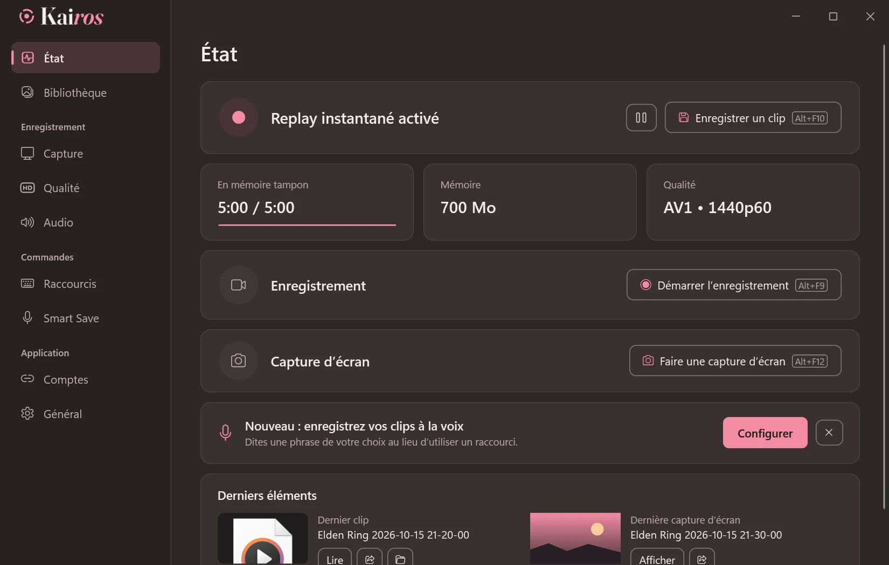
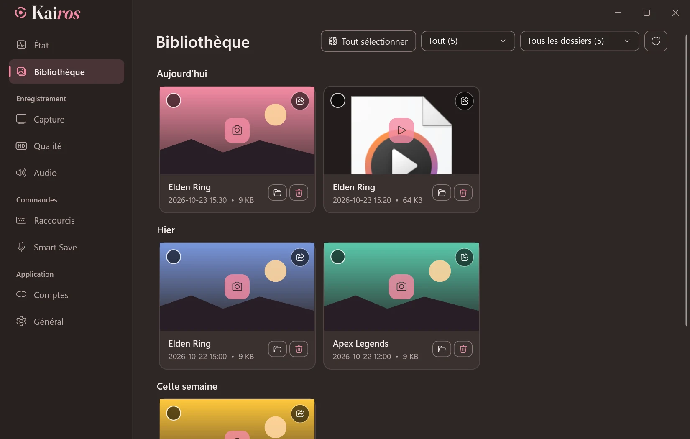
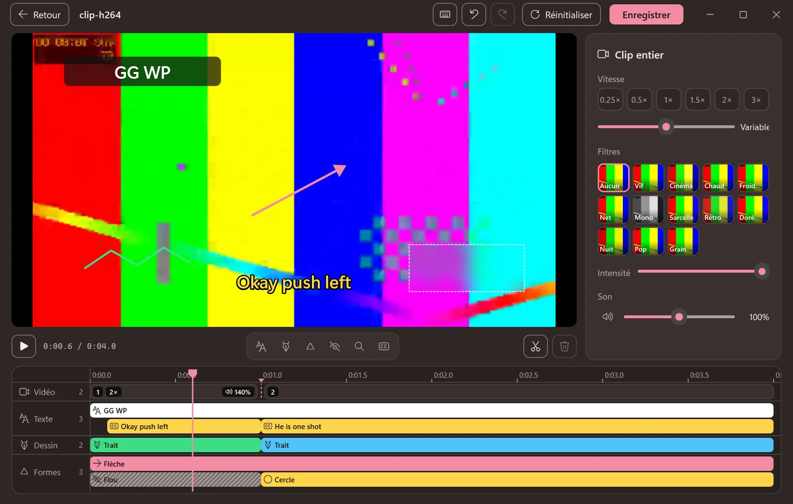
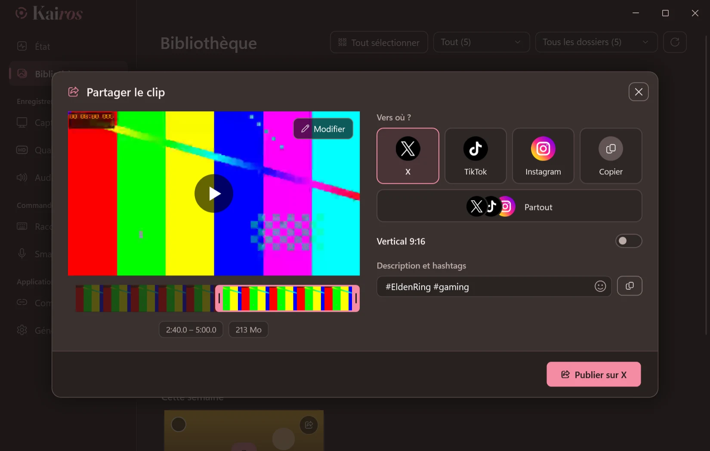
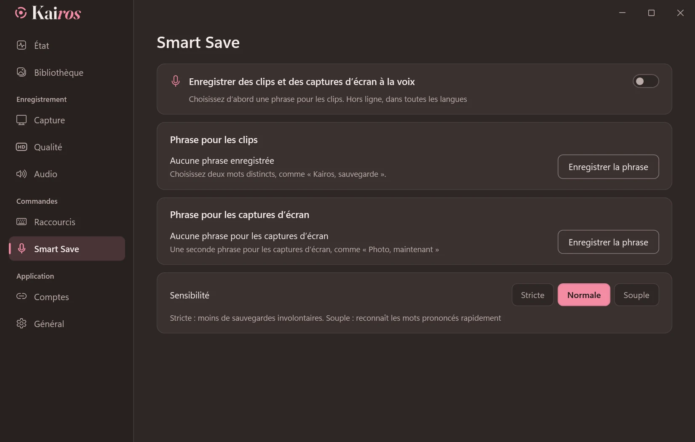
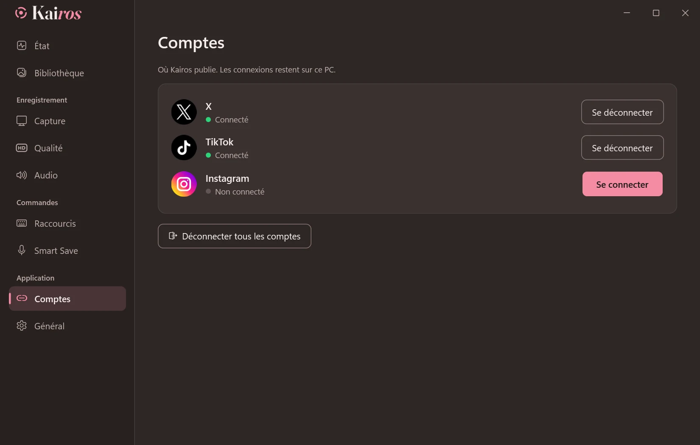

<p align="center">
  <picture>
    <source media="(prefers-color-scheme: dark)" srcset="media/logo-dark.png">
    
  </picture>
</p>

<h3 align="center">Le replay instantané pour les jeux Windows.</h3>

<p align="center">
  Appuyez sur une touche ou dites votre phrase : les cinq dernières minutes sont enregistrées.<br>
  Gratuit, open source, hors ligne et si léger que vous oublierez qu’il tourne.
</p>

<p align="center">
  <a href="https://github.com/BasilForge/Kairos/releases/latest"></a>
  <a href="https://discord.gg/QgqsGEWzaF"></a>
  
  
</p>

<p align="center">
  <a href="../README.md">English</a> ·
  <a href="README.ar.md">العربية</a> ·
  <a href="README.zh-Hans.md">简体中文</a> ·
  <a href="README.ru.md">Русский</a> ·
  <a href="README.es.md">Español</a> ·
  <a href="README.pt-BR.md">Português (Brasil)</a> ·
  <a href="README.de.md">Deutsch</a> ·
  <b>Français</b>
</p>

https://github.com/user-attachments/assets/c7afb475-f4a2-4356-acc5-327935e879e2

## Pourquoi Kairos

- **Ne manquez aucun moment.** Kairos conserve les 15 dernières secondes à 20 dernières minutes de jeu (5 minutes par défaut) sur votre disque ou en RAM. Appuyez sur `Alt+F10` pour en faire un clip.
- **Smart Save.** Enregistrez votre propre phrase, dans n’importe quelle langue, puis prononcez-la pour enregistrer un clip ou faire une capture d’écran. Tout fonctionne hors ligne.
- **Léger.** L’enregistrement utilise votre carte graphique. Mesures pendant une partie en 1440p60 AV1 : 0,4 % de processeur, aucune image perdue.
- **Montez sur place.** Coupez, changez la vitesse, ajoutez du texte, dessinez, floutez et créez des sous-titres automatiques sur votre PC.
- **Partagez en un clic.** Publiez sur X, TikTok et Instagram, ou sur les trois à la fois avec une seule description. Vous pouvez aussi copier le clip et le coller où vous voulez.
- **Privé.** Aucun compte Kairos, aucune télémétrie. Vos clips restent sur votre PC jusqu’à ce que vous les partagiez.

## Captures d’écran

Le français est sélectionné automatiquement si Windows est en français. Vous pouvez aussi le choisir dans **Settings → General → Language** (**Paramètres → Général → Langue**).

<table>
  <tr>
    <td width="50%"><p align="center"><sub>Replay instantané, enregistrement et captures d’écran en un coup d’œil</sub></p></td>
    <td width="50%"><p align="center"><sub>Tous vos clips et captures d’écran, par jour et par jeu</sub></p></td>
  </tr>
  <tr>
    <td width="50%"><p align="center"><sub>L’éditeur, avec des sous-titres automatiques créés sur votre PC</sub></p></td>
    <td width="50%"><p align="center"><sub>Publiez sur X, TikTok et Instagram</sub></p></td>
  </tr>
  <tr>
    <td width="50%"><p align="center"><sub>Smart Save : dites votre phrase pour enregistrer</sub></p></td>
    <td width="50%"><p align="center"><sub>Connectez-vous une fois ; les connexions restent sur votre PC</sub></p></td>
  </tr>
</table>

## Télécharger

1. Téléchargez **Kairos-Setup.exe** depuis la [dernière version](https://github.com/BasilForge/Kairos/releases/latest).
2. Lancez-le et suivez les étapes : choisissez la langue et le dossier (aucun droit administrateur requis), puis indiquez si vous voulez un raccourci sur le Bureau et le démarrage de Kairos avec Windows.
3. Jouez, puis appuyez sur `Alt+F10` lorsqu’un moment mérite d’être gardé.

Windows peut signaler un éditeur inconnu, car le programme d’installation n’est pas encore signé : choisissez **Informations complémentaires**, puis **Exécuter quand même**.
Les mises à jour se font depuis l’application, jamais pendant un enregistrement. La désinstallation conserve vos clips et vos paramètres.

**Configuration requise :** Windows 10 (version 2004 ou ultérieure) ou Windows 11, en 64 bits. Une carte graphique avec un encodeur vidéo (NVIDIA, AMD ou Intel) est recommandée.

## Fonctionnalités

<details>
<summary>Tout ce que fait Kairos</summary>

- **Capture :** écran entier, jusqu’à 5 applications (celle au premier plan est enregistrée) ou jeux détectés automatiquement, y compris en plein écran exclusif ou avec une image étirée, jusqu’en 4K à 30–240 i/s.
- **Replay instantané :** jusqu’à 20 minutes, sur disque (SSD ou HDD) ou en RAM, avec un clip court en complément et la possibilité de repartir de zéro après chaque sauvegarde.
- **Qualité automatique :** Kairos choisit l’encodeur, la résolution, la fréquence d’images et la qualité adaptés à votre PC, puis les réduit automatiquement si des images sont perdues.
- **Encodage :** AV1, HEVC ou H.264 sur NVIDIA (NVENC), AMD (AMF) ou Intel (Quick Sync). Si un encodeur ne démarre pas, Kairos essaie le suivant, jusqu’à x264.
- **Audio :** un mélangeur avec une ligne par source (jeu, Discord, musique, microphone, application ou périphérique), chacune avec son volume et, si vous le souhaitez, sa propre piste.
- **Caméra :** votre webcam ou téléphone dans un coin, carré ou rond, ou en haut d’une image verticale 9:16, avec la possibilité d’enregistrer la caméra séparément.
- **Enregistrement :** démarrez, mettez en pause et arrêtez avec des raccourcis ; un enregistrement mis en pause reste un seul fichier.
- **Captures d’écran :** un raccourci dédié, avec les images enregistrées à côté de vos clips.
- **Bibliothèque :** clips et captures d’écran classés par jour et filtrés par jeu ; glissez un clip directement dans Discord ; limitez la taille du dossier ; enregistrez dans OneDrive, Dropbox ou Google Drive et libérez les copies locales.
- **Éditeur :** coupez et assemblez, réglez la vitesse et le son par partie et par piste, zoomez sur une zone, ajoutez du texte avec de nombreuses polices et styles, des sous-titres automatiques, des dessins, des formes, du flou et des filtres, et recadrez les captures d’écran.
- **Sous-titres automatiques :** Whisper sur votre carte graphique. Le moteur et le modèle sont téléchargés une seule fois, avec votre accord, et peuvent être supprimés dans les paramètres.
- **Partage :** X, TikTok, Instagram ou les trois à la fois, via les pages officielles de chaque site ; copie adaptée aux limites Discord de 10, 50 ou 500 Mo ; sélection de l’extrait sur une bande d’images et recadrage en 9:16 ; copies conservées dans le sous-dossier `Shared` de votre dossier de clips.
- **Aide :** **Enregistrer un rapport**, sur la page **État**, crée sur votre Bureau un ZIP contenant les journaux et les paramètres, à envoyer sur Discord.
- **Huit langues :** anglais, arabe, chinois, russe, espagnol, portugais, allemand et français. Au premier lancement, Kairos suit la langue de Windows.
- **Discret :** démarre avec Windows dans la zone de notification, sans fenêtre ni son, sauf si vous les activez.

</details>

## Confidentialité

- Aucune télémétrie, aucune analyse d’utilisation, aucun compte Kairos.
- Kairos se connecte uniquement pour rechercher et télécharger une nouvelle version sur GitHub une fois par jour (vous pouvez désactiver cette vérification), publier ce que vous partagez via les pages officielles des sites et télécharger une seule fois le sous-titrage automatique avec votre accord (le moteur depuis GitHub, le modèle depuis Hugging Face).
- Vos clips restent dans votre dossier de clips, synchronisés uniquement si vous choisissez un dossier OneDrive, Dropbox ou Google Drive. Vos paramètres et journaux restent sur votre PC. Smart Save et les sous-titres automatiques écoutent uniquement sur votre PC, où votre phrase Smart Save est également enregistrée.
- Les connexions aux sites restent dans le navigateur propre à Kairos (Microsoft Edge WebView2, protégé par Windows comme dans Edge), jamais dans ses paramètres ou journaux. Se déconnecter d’un site déconnecte aussi le compte Google, Apple ou Facebook utilisé pour ce site.
- **Enregistrer un rapport** inclut les journaux et paramètres sans votre nom d’utilisateur Windows ni les titres des fenêtres, et n’inclut jamais vos connexions ou vos clips.
- Vous avez trouvé un problème de sécurité ? Signalez-le en privé : consultez la [politique de sécurité en français](../SECURITY.md#sécurité).

## Questions fréquentes

**Kairos est-il compatible avec les logiciels anti-triche ?**

Kairos ne lit ni ne modifie la mémoire des jeux. Pour capturer un jeu qui remplit l’écran dans tous les modes, y compris en plein écran exclusif ou avec une image étirée, il utilise le même mécanisme de capture signé et compatible avec les anti-triches qu’OBS Studio, autorisé par Riot Vanguard, Easy Anti-Cheat et BattlEye. Si ce mécanisme ne fournit aucune image pour un jeu, Kairos capture automatiquement l’écran pour éviter les clips noirs.

**Un cadre jaune apparaît-il pendant l’enregistrement ?**

Pas sous Windows 11. Sous Windows 10, Windows dessine lui-même un cadre jaune autour de l’application en mode **Applications** et ne permet pas de le masquer ; les modes **Écran entier** et **Jeux** n’en affichent pas.

**Mes clips saccadent au-delà de 60 i/s.**

Un clip ne peut pas être plus fluide que votre écran ou votre jeu : enregistrer à 144 i/s sur un écran 60 Hz répète les images de façon irrégulière. Kairos l’indique sous la fréquence d’images ; le mode **Automatique**, dans **Qualité**, ne dépasse jamais la fréquence de votre écran. 60 i/s conviennent à YouTube, X, TikTok et Instagram.

**Quelque chose ne fonctionne pas. Que dois-je envoyer ?**

Cliquez sur **Enregistrer un rapport** sur la page **État** : un ZIP contenant les journaux et paramètres apparaît sur votre Bureau. Envoyez-le sur notre [Discord](https://discord.gg/QgqsGEWzaF) ou dans une issue GitHub.

## Compiler depuis les sources

<details>
<summary>Pour les développeurs</summary>

Kairos est une application .NET 10 (WPF et WinForms) qui utilise **libobs**, le moteur d’[OBS Studio](https://obsproject.com), avec uniquement les modules nécessaires, ainsi que FFmpeg pour le montage et le partage.

```powershell
.\tools\build-whisper.ps1               # Une fois : moteur de sous-titrage (SDK Vulkan et VS Build Tools requis)
.\tools\release.ps1                     # Installation, mises à jour et sources dans releases\ (vpk 1.2.161 requis)
dotnet run --project tests\Kairos.Tests # Les tests
```

La compilation copie libobs 32.2.2 depuis une installation d’OBS Studio.

</details>

## Licence

Kairos est un logiciel libre sous [licence publique générale GNU version 2.0 ou ultérieure](../LICENSE), comme libobs. Chaque version inclut son code source complet. Les composants tiers et leurs licences sont répertoriés dans [THIRD-PARTY-NOTICES.md](../THIRD-PARTY-NOTICES.md).

<sub>*Kairos* (καιρός) signifie « le bon moment » en grec.</sub>
